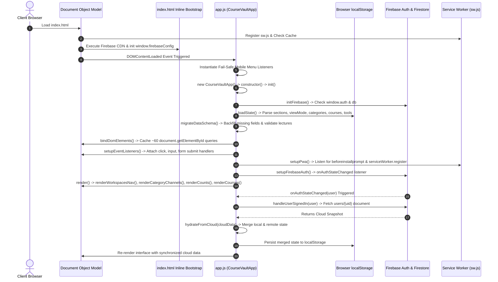
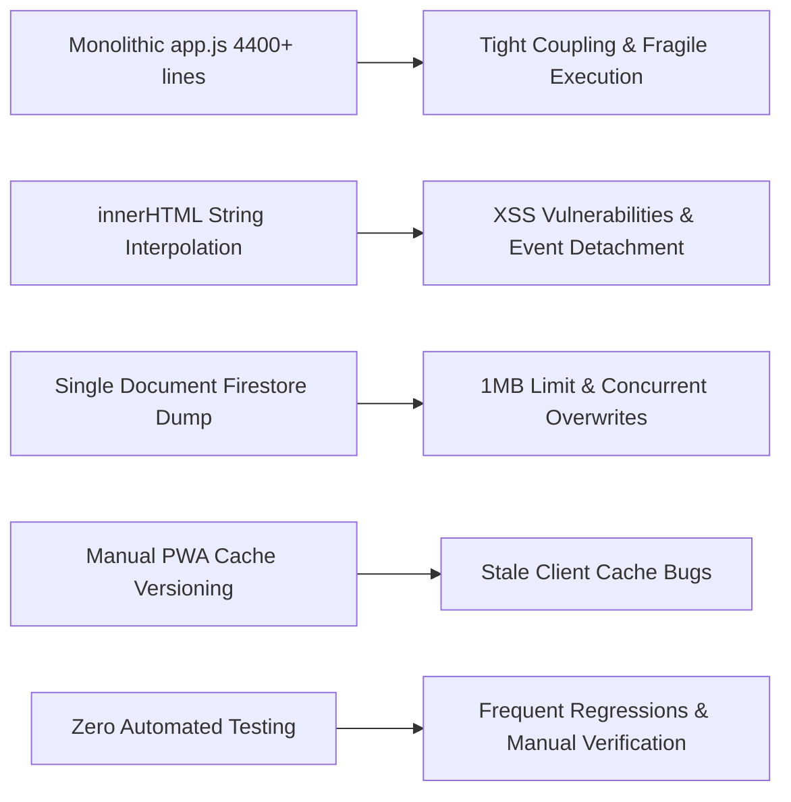
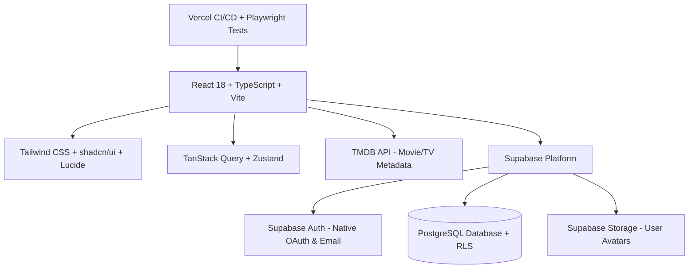

# Comprehensive Technical Audit of CourseVault: Architectural Lessons & Engineering Blueprint for TrackUp

---

## 1. Executive Summary

This technical audit documents the architecture, implementation patterns, strengths, failure modes, and security posture of **CourseVault** (published at `https://ah107gemi.github.io/CourseVault/`), a standalone Progressive Web Application (PWA) designed for curating and tracking online courses, lectures, and developer utilities.

The primary objective of this audit is to extract actionable engineering lessons to directly inform the development of **TrackUp**, a modern, multi-user movie and TV-show tracking platform built with **React, TypeScript, Tailwind CSS, shadcn/ui, Lucide Icons, Supabase (PostgreSQL + RLS), TMDB API, and Playwright**.

### High-Level Summary of Findings

1. **Architecture Model**: CourseVault was constructed as a single-page, zero-build application using pure vanilla JavaScript (ES6+), semantic HTML5, and utility-free CSS3. All application logic resides in a single monolithic class (`CourseVaultApp` in `app.js`, 4,436 lines), paired with a single 1,165-line HTML shell (`index.html`) and a 4,765-line monolithic stylesheet (`style.css`).
2. **Persistence & Data Model**: Data persistence relies on browser `localStorage` as the primary operational store, coupled with an asynchronous cloud synchronization engine targeting Google Cloud Firestore (`users/{uid}` document). All user data (courses, lectures, tools, categories, and workspaces) is aggregated into a single monolithic JSON document.
3. **Authentication Strategy**: CourseVault implements a dual authentication layer: native Google OAuth via Firebase Auth, and an abstraction providing Username + PIN authentication mapped internally to synthetic email/password credentials (`${username}@coursevault.internal`).
4. **Key Strengths**: Rapid initial load time (zero bundle parsing overhead), resilient offline support via a dual-tier service worker (`sw.js`), sophisticated client-side image compression via HTML5 `<canvas>`, non-blocking optimistic UI updates, and an intuitive dark-tech aesthetic with Champagne Gold accents.
5. **Critical Vulnerabilities & Weaknesses**: Lack of component modularity, fragile manual DOM string interpolation (`innerHTML`) with unescaped URI scheme injection vectors (`javascript:` pseudo-protocols), document-size bottlenecks in Firestore (1 MB hard limit threatened by Base64 images), lack of atomic database transactions, absence of automated testing, and brittle global namespace dependencies that historically caused severe startup halts.
6. **Relevance to TrackUp**: TrackUp requires a multi-user relational schema (users, media items, seasons, episodes, watchlists, reviews, social follower graphs) that cannot scale on CourseVault's document-dump pattern. However, CourseVault's UX paradigms (view modes, status segment controllers, offline fallback caching, debounced cloud syncing, and mobile safe-area navigation) provide invaluable design patterns that will be adapted into a modern TypeScript + React + Supabase stack.

---

## 2. Verified Technology Stack

All technology determinations below are verified directly from repository source code analysis:

| Layer | CourseVault Implementation | Verification Source |
| :--- | :--- | :--- |
| **Language & Runtime** | Vanilla ECMAScript (ES2020+), HTML5, CSS3 | [`app.js`](app.js), [`index.html`](index.html), [`style.css`](style.css) |
| **Frameworks / UI Libraries** | **None** (Zero frameworks; pure native DOM manipulation) | Source inspection; absence of `package.json` |
| **Build System & Tooling** | **None** (No bundler, Vite, Webpack, or Babel; raw scripts) | Direct file serving; GitHub Pages deployment |
| **Client Persistence** | Browser `localStorage` API | `STORAGE_KEY_*` constants in [`app.js`](app.js#L10-L14) |
| **Cloud Database** | Google Cloud Firestore (Compat SDK v10.14.0) | `<script src="...firebase-firestore-compat.js">` |
| **Authentication** | Firebase Authentication (Google OAuth + Synthetic Email/Password) | `<script src="...firebase-auth-compat.js">` |
| **Offline & PWA** | Service Worker Cache Storage API + W3C Web App Manifest | [`sw.js`](sw.js), [`manifest.json`](manifest.json) |
| **Asset Pipeline** | Headless Microsoft Edge + PowerShell `System.Drawing` script | [`generate_icons.py`](generate_icons.py) |
| **Local Development** | Python 3 `http.server` with custom MIME typing & CORS | [`server.py`](server.py) |
| **Hosting & CI/CD** | GitHub Pages branch deployment (`main` branch) | `.git/config` remote `origin` |

---

## 3. Project Directory Structure

```text
CourseVault/
├── .git/                                # Git version control metadata (20 commits)
├── .gitignore                           # Ignores OS metadata, Python cache, local server/backups
├── app.js                               # Monolithic client logic & state store (4,436 lines / 184 KB)
├── favicon.ico                          # Multi-resolution favicon asset (766 bytes)
├── generate_icons.py                    # Automation script for PWA icon generation via headless Edge
├── index.html                           # App shell, 9 modal dialogs, and SVG iconography (1,165 lines / 63 KB)
├── manifest.json                        # W3C Web App Manifest for standalone mobile PWA installation
├── README.md                            # End-user documentation, feature overview, and install guide
├── server.py                            # Standalone Python local dev server with CORS & MIME mappings
├── style.css                            # Monolithic stylesheet with CSS variables & media queries (4,765 lines / 99 KB)
├── sw.js                                # Dual-tier Service Worker caching & offline engine (110 lines / 3.6 KB)
├── icons/                               # PWA application icons
│   ├── icon.svg                         # Vector master logo ("The Digital Collection" layered mark)
│   ├── icon-192.png                     # Standard mobile icon (192x192 PNG)
│   └── icon-512.png                     # High-density splash/store icon (512x512 PNG)
└── full data project backed up/         # Ignored directory for manual JSON export snapshots
    └── coursevault-backup-2026-10-18.json
```

### Responsibility of Key Files

- **`index.html`**: Defines the full static markup of the application shell, desktop sidebar, mobile bottom navigation bar, view panels, and 9 modal overlay dialogs. Also loads external Firebase CDN libraries.
- **`app.js`**: Houses the entire frontend controller (`CourseVaultApp` class), encapsulating state variables, data migrations, DOM element bindings, event listeners, YouTube regex extractors, Canvas image compression, Firestore synchronization, and HTML string rendering engines.
- **`style.css`**: Defines design tokens (CSS variables for dark theme, typography, spacing, border radii), component classes, modal layouts, desktop-versus-mobile layout separation, and responsive breakpoints (`@media (max-width: 768px)`, `@media (max-width: 500px)`).
- **`sw.js`**: Intercepts network requests to implement a dual-tier caching strategy: Stale-While-Revalidate for application code, and Cache-First/Network-First for external media (YouTube thumbnails and Google CDN scripts).
- **`server.py`**: A zero-dependency Python script enabling local development with proper MIME-type headers (specifically `application/manifest+json`) and LAN-wide Wi-Fi IP binding (`0.0.0.0:3000`) for mobile hardware debugging.

---

## 4. Application Architecture Explanation

### 4.1 Application Initialization & Lifecycle Flow

CourseVault uses a synchronous bootstrap flow executed once the browser dispatches `DOMContentLoaded`:



### 4.2 Component & Section Breakdown

The user interface is organized into distinct spatial zones:

1. **Top Application Header (`.app-header`)**:
   - Desktop: Brand mark, workspace indicator, global search input, quick "+ Add" action, PWA offline status badge, and Backup/Restore launcher.
   - Mobile: Refactored into a two-row header with a top brand bar and a dedicated full-width search bar below.
2. **Left Navigation Sidebar (`.sidebar-channels`)**:
   - Houses the Global Omnisearch box (with real-time autocomplete results), dynamic Workspaces list, Channel/Category filter chips, and the Account/Cloud Sync widget.
   - On mobile, this element transforms into a slide-over drawer triggered by bottom navigation.
3. **Main Content Viewport (`.main-content`)**:
   - Contains mutually exclusive view panels:
     - **Courses Panel (`#coursesViewPanel`)**: Status segment filter tabs (*All, Want to Learn, In Progress, Completed*), View Mode Switcher (*Grid, Compact, List*), Sorting selector, and the Course Cards Grid.
     - **Tools Panel (`#toolsViewPanel`)**: Category filter tabs and utility cards grid.
4. **Mobile Bottom Navigation Bar (`.mobile-bottom-bar`)**:
   - Fixed at viewport bottom with safe-area padding (`env(safe-area-inset-bottom)`). Provides thumb-friendly triggers for Menu/Workspaces, Add Item (Floating Action Button), and Backup.
5. **Modal System (9 Dialog Overlays)**:
   - Centered dialogs with high z-index layers (`z-index: 200` to `z-index: 1100`), backdrop blur, touch-scroll isolation, and accessible close triggers.

### 4.3 Data Movement & State Propagation

State in CourseVault is held in plain in-memory JavaScript arrays and primitive properties on the `CourseVaultApp` instance:
- `this.courses = []`
- `this.categories = []`
- `this.tools = []`
- `this.sections = []`
- `this.activeSectionId = 'courses'`
- `this.activeCategoryFilter = 'all'`
- `this.activeStatusFilter = 'all'`
- `this.viewMode = 'grid'`

When an action occurs (e.g., adding a course, toggling a lecture checkbox, creating a workspace):
1. **Mutation**: The in-memory array is updated directly (e.g., `course.lectures.push(newLec)`).
2. **Local Persistence**: A synchronous serialization method is invoked (e.g., `this.saveCourses()`), executing `localStorage.setItem('coursevault_courses_v1', JSON.stringify(this.courses))`.
3. **Cloud Synchronization**: `this.scheduleCloudSync()` is called, which clears any active timer and sets a 1,000ms debounce timeout to execute `this.syncToCloud()`.
4. **UI Repaint**: `this.render()` is called, which wipes container `innerHTML` and re-evaluates all filtering, sorting, and HTML generation from scratch.

---

## 5. Data-Storage and Persistence Analysis

### 5.1 Storage Architecture

```mermaid
graph TD
    UI[User Interaction / CRUD] --> Memory[In-Memory Instance State: this.courses]
    Memory -->|Synchronous JSON.stringify| LS[(Browser localStorage)]
    Memory -->|Debounced 1000ms| CloudSync[syncToCloud Engine]
    CloudSync -->|Atomic Document Overwrite| FS[(Firestore: users/{uid})]
    FS -->|onSnapshot Listener| RemoteSync[hydrateFromCloud Engine]
    RemoteSync -->|Merge Array IDs| Memory
```

### 5.2 Persistence Keys and Schemas

CourseVault manages five distinct keys in `localStorage`:

1. `coursevault_courses_v1`: Array of course objects.
   - Fields: `id` (string), `sectionId` (string), `title` (string), `url` (string), `normalizedUrl` (string), `videoId` (string|null), `playlistId` (string|null), `thumbnailUrl` (string), `customThumbnailUrl` (string), `category` (string), `status` (string), `notes` (string), `lectures` (array of lecture objects), `createdAt` (ISO string).
2. `coursevault_categories_v1`: Array of category objects (`id`, `name`, `color`, `sectionId`).
3. `coursevault_tools_v1`: Array of web tool objects (`id`, `sectionId`, `name`, `url`, `category`, `description`, `createdAt`).
4. `coursevault_sections_v2`: Array of workspace sections (`id`, `title`, `shortName`, `icon`, `description`, `isDefault`).
5. `coursevault_view_mode_v2`: String literal (`'grid'` | `'compact'` | `'list'`).

### 5.3 Backup & Migration Engine

- **JSON Export**: Serializes all five state arrays into a formatted JSON structure with application metadata (`version: "2.0.0"`, `exportedAt: ISO timestamp`) and triggers an automatic browser download via dynamic `<a>` tag creation with `data:application/json;charset=utf-8`.
- **JSON Import**: Accepts uploaded JSON files, validates the schema structure, and offers two modes: **Merge** (appends non-duplicate records based on ID and normalized URL) or **Replace** (completely clears and overwrites state).
- **Schema Migration (`migrateDataSchema`)**: Runs on every startup. Normalizes legacy schema structures (e.g., backfilling missing `sectionId: 'courses'`, generating missing YouTube thumbnail URLs, and guaranteeing `lectures` is an Array).

---

## 6. Authentication and Security Assessment

### 6.1 Authentication Mechanism Breakdown

CourseVault provides two distinct authentication flows in [`app.js`](app.js#L421-L750):

1. **Google OAuth 2.0**:
   - Initiated via `firebase.auth().signInWithPopup(new firebase.auth.GoogleAuthProvider())`.
   - Includes graceful fallback: if mobile browser popup blockers intercept the window, it automatically switches to `signInWithRedirect()`, which resolves on page reload via `auth.getRedirectResult()`.
2. **Username + PIN Synthetic Authentication**:
   - Designed to avoid asking users for an email address.
   - Sanitizes username: `cleanUser = rawUser.trim().toLowerCase().replace(/[^a-z0-9]/g, '')`.
   - Constructs a synthetic credential:
     - Synthetic Email: `${cleanUser}@coursevault.internal`
     - Synthetic Password: `${pin}__vault` (appends 7 characters to satisfy Firebase's 6-character minimum).
   - Authenticates using `auth.signInWithEmailAndPassword()` or registers using `auth.createUserWithEmailAndPassword()`.

### 6.2 Security Vulnerability Analysis

| Vulnerability | Severity | Code Location | Risk Description |
| :--- | :--- | :--- | :--- |
| **Monolithic Document Collision** | **Critical** | [`app.js:614`](app.js#L614) | Storing all user courses, lectures, and tools in a single document (`users/{uid}`) hits Firestore's **1 MB document limit**. Base64 images stored in custom covers accelerate this failure. |
| **Unsanitized Link Pseudo-Protocols (XSS)** | **High** | [`app.js:3948`](app.js#L3948), [`app.js:3338`](app.js#L3338) | Course URLs and lecture companion links are rendered as `<a href="${escapeHtml(course.url)}">`. `escapeHtml` neutralizes HTML tags but permits `javascript:` pseudo-protocols, allowing stored XSS via imported JSON. |
| **Predictable Synthetic PIN Entropy** | **High** | [`app.js:735`](app.js#L735) | A 4-digit PIN has only 10,000 combinations. The synthetic password mapping (`${pin}__vault`) uses a static salt, exposing user accounts to brute-force credential stuffing via Firebase client APIs. |
| **Global Account Namespace Hijacking** | **Medium** | [`app.js:735`](app.js#L735) | Usernames are registered directly in the synthetic `@coursevault.internal` domain. Any user who registers a common name (e.g., `alex`) permanently locks out all other users across the application. |
| **Exposed Client Configuration** | **Low** | [`index.html:1140`](index.html#L1140) | Firebase API credentials are commited in plain text. (Standard for Firebase web apps, but requires strict Firestore Security Rules to prevent unauthorized data reading/wiping). |

---

## 7. UI and Responsive-Design Assessment

### 7.1 Visual System & Design Tokens

CourseVault implements a cohesive "Dark-Tech Champagne Gold" design system defined in [`style.css`](style.css#L1-L60):
- **Surface Palette**: Base `#0B0D11`, Surface `#12161F`, Card `#161B26`, Hover `#1D2331`, Overlay `rgba(8, 10, 14, 0.85)`.
- **Accent Tokens**: Champagne Gold (`#D4AF37`), Light Gold (`#E5C578`), Gold Glow (`rgba(212, 175, 55, 0.2)`).
- **Status Semantic Colors**: Want to Learn (Slate Blue `#93A4BA`), In Progress (Gold `#D4AF37`), Completed (Emerald `#10B981`).
- **Typography Scale**: Sans: `Plus Jakarta Sans`, Monospace: `JetBrains Mono`.

### 7.2 Responsive Architecture & Mobile Viewports

CourseVault cleanly separates desktop and mobile ergonomics through explicit viewport breakpoints:

1. **Desktop Viewport (`> 768px`)**:
   - Two-column fixed sidebar layout (`270px` width) with independent content scroll.
   - Header action bar with inline omnisearch, direct modal launchers, and backup utilities.
   - Mobile bottom bar is completely removed from the rendering tree (`display: none !important;`).
2. **Mobile Viewport (`<= 768px`)**:
   - Sidebar converted into an off-canvas drawer (`transform: translateX(-100%)`) with a backdrop overlay (`z-index: 140`).
   - Sticky bottom navigation bar (`height: 64px`, `z-index: 160`) with safe-area padding (`env(safe-area-inset-bottom)`).
   - Two-row app header: Row 1 holds brand and icon triggers; Row 2 holds full-width search input.
   - Modals adapt to mobile touchscreens: `max-height: calc(100dvh - 2rem)`, top alignment, sticky headers, touch-scrollable bodies with `overscroll-behavior: contain;`, and `padding-bottom: calc(50vh + 1rem)` to keep inputs visible above software keyboards.

---

## 8. Testing and Deployment Assessment

### 8.1 Testing State
- **Automated Tests**: **None**. There are no unit tests (Jest/Vitest), component tests, or committed end-to-end browser test suites.
- **Verification Methodology**: Verification during development relied entirely on temporary scratch Node.js automation scripts communicating directly with headless Microsoft Edge via the Chrome DevTools Protocol (CDP).
- **Risk**: Any change to modal markup, CSS class names, or event listener attachment orders is vulnerable to silent regressions without immediate automated test feedback.

### 8.2 Deployment Pipeline
- **Hosting**: GitHub Pages serving static files directly from the `main` branch.
- **Build Step**: **None**. Files pushed to `main` are immediately deployed live.
- **Cache Invalidation**: Handled manually via the `CACHE_NAME` constant in `sw.js` (currently `coursevault-v2.9.1`). If a developer forgets to bump this version string, client devices with active service workers continue running cached, outdated JavaScript and CSS.

---

## 9. Strengths Worth Preserving

These patterns in CourseVault are exceptionally well executed and should be translated into TrackUp:

1. **Dual-Tier Service Worker Caching Architecture**:
   - Separating application shell assets (HTML, CSS, JS) from dynamic external media (thumbnails, posters) ensures instantaneous launch times while preventing cache storage bloat.
2. **Multi-Mode View Rendering (`Grid`, `Compact`, `List`)**:
   - Users possess distinct consumption styles. Offering high-density list rows alongside visual cover cards significantly enhances user satisfaction.
3. **Client-Side Canvas Image Compression**:
   - Resizing and re-encoding uploaded image files via HTML5 `<canvas>` before saving prevents browser memory crashes and keeps payload sizes predictable.
4. **Debounced Optimistic Cloud Synchronization**:
   - Writing immediately to local storage while batching/debouncing remote database calls (1,000ms delay) guarantees a snappy, zero-latency user experience regardless of network quality.
5. **Safe-Area Mobile UX Design**:
   - Explicit handling of mobile browser address bar retracts, notch safe-areas (`env(safe-area-inset-bottom)`), virtual keyboard viewport resizing, and bottom-bar elevation ensures a native app experience on mobile devices.
6. **Robust Keyboard Accessibility & Global Omnisearch**:
   - Global shortcuts (`Cmd+K`, `/`, `Escape`) and real-time dropdown search provide an efficient power-user workflow.

---

## 10. Weaknesses and Lessons Learned

These architectural issues in CourseVault represent critical lessons to avoid in TrackUp:



### 1. Monolithic Architecture is Hard to Maintain
- **Finding**: Putting 4,436 lines of state, networking, validation, business logic, and UI templates into a single class makes navigation, refactoring, and collaboration error-prone.
- **Lesson for TrackUp**: TrackUp must adopt modular, component-based architecture using React and TypeScript, strictly separating presentation, business logic (hooks), and database access.

### 2. Manual DOM String Interpolation (`innerHTML`) is Dangerous
- **Finding**: Constructing complex card and modal layouts using template literals (`card.innerHTML = ...`) requires manually binding event listeners after every render, causes cursor focus jumping during input typing, and creates cross-site scripting risks.
- **Lesson for TrackUp**: Use React's declarative JSX and virtual DOM reconciliation to manage UI updates safely and maintain cursor stability automatically.

### 3. The "Single-Document-per-User" Pattern Does Not Scale
- **Finding**: Dumping all courses, lectures, categories, and settings into one Firestore document (`users/{uid}`) causes atomic write contention, prevents partial updates, and risks hitting document size limits.
- **Lesson for TrackUp**: Use Supabase's normalized PostgreSQL database with relational tables, foreign keys, row-level security, and indexed queries.

### 4. Synthetic Authentication is Insecure for Real Multi-User Applications
- **Finding**: Mapping usernames to synthetic internal email addresses with static password salts prevents password recovery and enables brute-force discovery.
- **Lesson for TrackUp**: Use Supabase Authentication's native user management with secure password hashing (bcrypt), email verification, and OAuth providers.

### 5. Manual Cache Invalidation Causes Stale Deployment Bugs
- **Finding**: Relying on developers to manually increment `const CACHE_NAME = 'coursevault-v2.9.1'` in `sw.js` led to multiple mobile caching bugs during CourseVault development.
- **Lesson for TrackUp**: Rely on modern bundlers (Vite/Next.js) hosted on Vercel with content-hash file naming (`main.[hash].js`) and atomic deployments.

---

## 11. CourseVault versus TrackUp Architecture Comparison

| Architectural Area | CourseVault Implementation | Reusable Lesson or Pattern | TrackUp Requirement | Recommended Approach for TrackUp |
| :--- | :--- | :--- | :--- | :--- |
| **Frontend Framework** | Pure Vanilla JS (ES6+), zero frameworks | Keep DOM manipulation minimal; fast startup | Interactive UI with dynamic nested states (seasons, episodes, reviews) | **React 18/19 + TypeScript**: Modular components with type safety. |
| **State Management** | Monolithic mutable class properties (`this.courses = []`) | Centralized state store; optimistic UI updates | Multi-entity relational state (user, media details, watchlists, social) | **Zustand** or **TanStack Query (React Query)** for server state caching. |
| **Database & Schema** | Single JSON document per user in Firestore | Document schema versioning and data migration functions | Normalized relational schema (users, titles, watchlists, logs, reviews, follows) | **Supabase (PostgreSQL)**: Normalized tables with Foreign Keys and Indexes. |
| **Security & Access** | Client-side authorization; open Firestore rules | Document-level ownership checking | Multi-user privacy: private watchlists, public reviews, friend activity feeds | **Supabase Row-Level Security (RLS)**: Enforced directly at the database engine level. |
| **Authentication** | Google OAuth + Synthetic Username/PIN | Fallback redirect sign-in for mobile popup blockers | Secure multi-user registration, password resets, profile management | **Supabase Auth**: Native email/password, magic link, and Google OAuth. |
| **Media Metadata** | Custom regex parser extracting YouTube video/playlist IDs | Canvas image compression for user uploads; dynamic SVG placeholders | Extensive movie/TV metadata, posters, backdrops, release dates, cast | **TMDB API (v3/v4)**: Integrated via backend edge functions with caching. |
| **Styling & Design** | Monolithic 4,765-line CSS file with CSS custom properties | High-contrast Dark-Tech aesthetic; safe-area notch padding | Cinematic dark entertainment dashboard; responsive detail pages | **Tailwind CSS + shadcn/ui**: Utility-first styling with unified design tokens. |
| **Icons & Assets** | Raw inline SVGs (~30 custom SVG blocks duplicated in markup) | Semantic icon sizing and consistent stroke widths | Rich media UI (playback, ratings, stars, filters, cast icons) | **Lucide Icons (`lucide-react`)**: Tree-shakeable, clean React components. |
| **UI Components** | Custom raw HTML/CSS dialogs (9 modals in `index.html`) | Accessible dialogs with Escape dismissal and backdrop click exit | Accessible sheets, dialogs, dropdowns, popovers, rating sliders | **Radix UI / shadcn/ui**: Fully accessible, WAI-ARIA compliant primitives. |
| **Build & Deploy** | Raw file serving on GitHub Pages; manual SW versioning | Fast static hosting; service worker offline capabilities | Automated CI/CD, TypeScript compilation, environment variables, PR previews | **Vercel + GitHub Actions**: Automated builds, edge caching, and preview URLs. |
| **Testing** | Manual browser verification + ad-hoc CDP Node scripts | Headless browser CDP automation scripts for mobile viewports | Automated regression prevention across complex tracking flows | **Playwright**: End-to-end browser test suites testing auth, search, and tracking. |

---

## 12. Evaluation & Recommendations for TrackUp Technology Stack



### 12.1 Frontend: React + TypeScript + Vite
- **Assessment**: **Highly Recommended**.
- **Reasoning**: TrackUp's UI involves complex, nested interactive components (e.g., season accordion with individual episode checkmarks, rating star selectors, dynamic review feeds). Building this in vanilla JS like CourseVault would result in an unmaintainable codebase exceeding 15,000 lines. TypeScript ensures data contracts from the TMDB API and Supabase are strictly typed.

### 12.2 UI System: Tailwind CSS + shadcn/ui + Lucide Icons
- **Assessment**: **Highly Recommended**.
- **Reasoning**: CourseVault's 4,765-line `style.css` suffered from CSS specificity collisions and orphaned style rules. Tailwind CSS scopes styles directly to components. shadcn/ui (built on Radix UI primitives) provides accessible modals, popovers, command palettes (Omnisearch), and tabs out-of-the-box, saving hundreds of hours of manual CSS debugging.

### 12.3 Backend & Database: Supabase (PostgreSQL + RLS)
- **Assessment**: **Highly Recommended**.
- **Reasoning**: Supabase completely resolves CourseVault's primary architectural bottleneck. PostgreSQL allows properly normalized relational tables:
  - `profiles` (user data, avatars)
  - `watchlists` (user_id, media_id, media_type, status)
  - `episode_progress` (user_id, show_id, season_number, episode_number, watched_at)
  - `reviews` (user_id, media_id, rating, review_text, created_at)
  - `follows` (follower_id, following_id)
  Row-Level Security (RLS) ensures users can only edit their own data while allowing public reading of reviews and profiles.

### 12.4 Metadata Provider: TMDB API
- **Assessment**: **Essential Requirement**.
- **Implementation Note**: Do not query TMDB directly from client components with an exposed client API key. Create a lightweight proxy or Supabase Edge Function to cache TMDB responses, avoid rate limits, and protect API secrets.

### 12.5 Testing & Deployment: Playwright + Vercel
- **Assessment**: **Highly Recommended**.
- **Reasoning**: Playwright enables automated multi-device testing (desktop and mobile viewports) directly in CI/CD pipelines. Vercel provides seamless GitHub deployments, automatic HTTPS, environment variable management, and eliminates CourseVault's service worker cache-stale issues.

---

## 13. Verified Facts versus Unresolved Questions

### 13.1 Verified Facts from Source Code Inspection
- CourseVault has **0 external dependencies** and no `package.json`.
- The entire application runs client-side from three core files: `index.html`, `style.css`, and `app.js`.
- Client persistence is powered by five explicit `localStorage` keys.
- Remote synchronization targets a single document path (`users/{uid}`) in Cloud Firestore.
- Mobile PWA capabilities are backed by an active Service Worker (`sw.js`) utilizing Cache Storage.
- CourseVault has **no automated unit or integration test suite** in its repository.
- There are no backend build steps or server-side functions; deployment is purely static on GitHub Pages.

### 13.2 Unresolved Questions / Out-of-Scope Items
- **Firestore Security Rules**: The security rules enforced on the `coursevault-36c69` Firebase project cannot be inspected from the frontend repository (they reside in the Firebase Console). It is unknown whether the database is protected by proper auth checks or open to the public.
- **Firebase Project Billing & Quotas**: Real-world cloud document usage, bandwidth consumption, and quota limits for the live CourseVault Firebase instance cannot be inspected from code.

---

## 14. Implementation Checklist for Gemini: TrackUp Specification Prompt

When preparing the master prompt to build **TrackUp**, verify that the following architectural items are explicitly specified:

### 1. Database Architecture & Schema
- [ ] Define normalized PostgreSQL tables in Supabase: `profiles`, `titles`, `watchlists`, `episodes_tracked`, `reviews`, `user_follows`.
- [ ] Specify Row-Level Security (RLS) policies for each table (owner-write, public-read where applicable).
- [ ] Define appropriate PostgreSQL indexes on `user_id`, `media_id`, and `created_at` to guarantee sub-50ms query times.

### 2. Authentication & User Management
- [ ] Specify Supabase native Auth (Email/Password + Google OAuth).
- [ ] Discard CourseVault's synthetic email/password PIN workaround; use proper user credentials.
- [ ] Create an automatic database trigger (`handle_new_user`) that initializes a `profiles` row upon signup.

### 3. API Integration & Caching
- [ ] Specify TMDB API v3 endpoints for Trending, Search, Movie Details, TV Show Details, and Season/Episode information.
- [ ] Implement a request caching layer (using TanStack Query `staleTime: 1000 * 60 * 10`) to minimize duplicate network roundtrips.
- [ ] Store image paths (`poster_path`, `backdrop_path`) as relative TMDB strings, concatenating CDN base URLs (`https://image.tmdb.org/t/p/w500`) dynamically.

### 4. Component Hierarchy & Layout
- [ ] Adopt CourseVault's desktop vs. mobile layout separation:
  - Desktop: Fixed collapsible left sidebar navigation (`dashboard`, `discover`, `watchlist`, `history`, `friends`).
  - Mobile: Bottom navigation bar with safe-area padding (`env(safe-area-inset-bottom)`) and off-canvas slide-out sheet.
- [ ] Implement three viewing modes for watchlists: Poster Grid, Compact Grid, and Detailed Table/List.
- [ ] Implement a cinematic Detail View with backdrop hero banner, title metadata, action buttons (*Add to Watchlist*, *Mark Watched*, *Rate*), and cast carousel.

### 5. UI Polish & Ergonomics (Lessons from CourseVault)
- [ ] Use CSS safe-area insets (`env(safe-area-inset-top)` and `env(safe-area-inset-bottom)`) for all fixed headers and bottom navigation bars.
- [ ] Implement a global Command Menu / Omnisearch dialog (`Cmd+K`) using shadcn/ui `Command` primitive.
- [ ] Prevent mobile keyboard input occlusion by wrapping forms in scrollable containers with adequate bottom padding.
- [ ] Use Lucide React icons instead of raw inline SVG strings.
- [ ] Enforce strict URI sanitization: validate external links against `https://` protocols to prevent `javascript:` XSS attacks.

### 6. Testing & Deployment
- [ ] Set up Playwright automated tests verifying:
  - User authentication and session persistence.
  - Search query execution and TMDB result rendering.
  - Watchlist status toggling (*Planned*, *Watching*, *Completed*).
  - Responsive mobile drawer toggle and navigation interactions.
- [ ] Deploy via Vercel with automatic continuous deployment on GitHub `main` branch.
